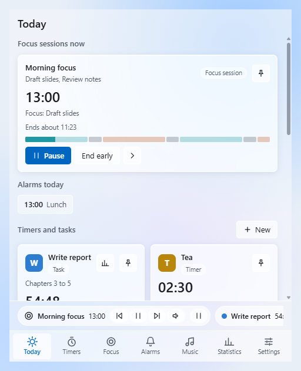
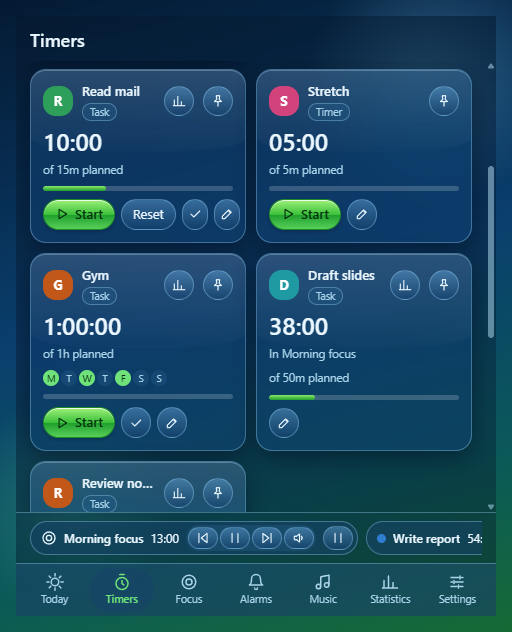
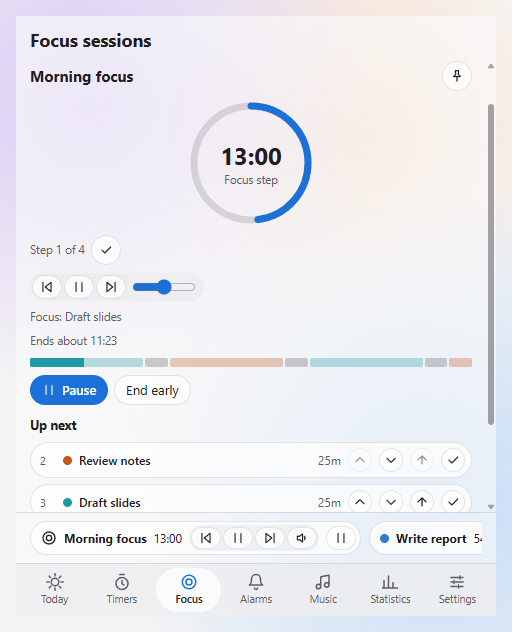
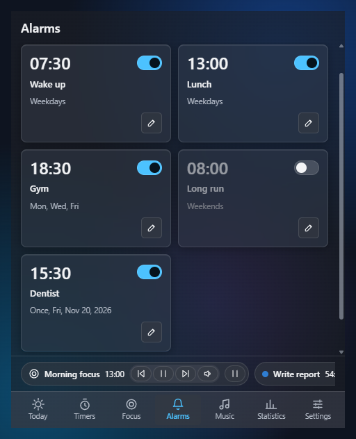
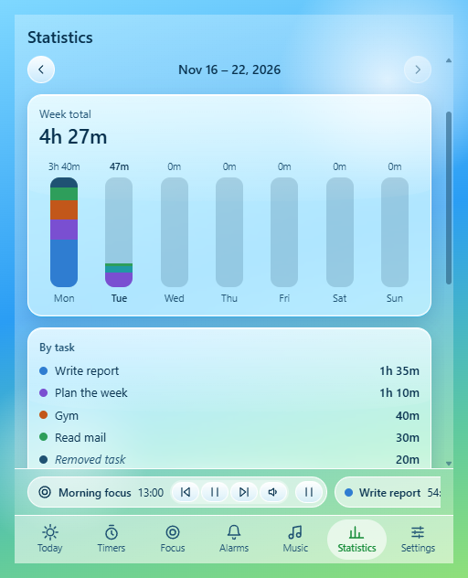
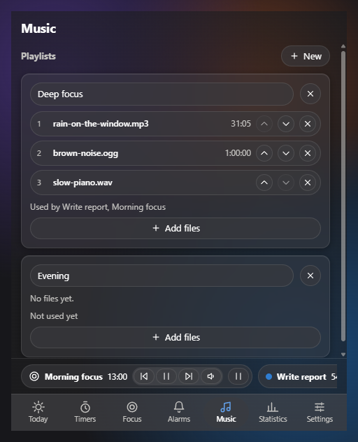
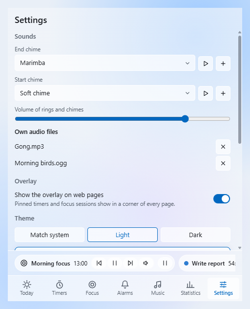
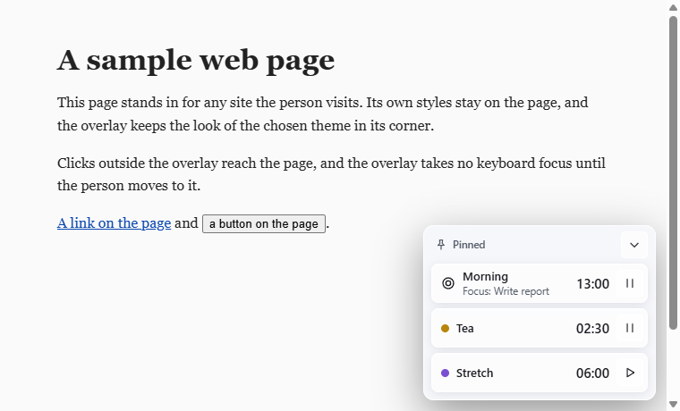
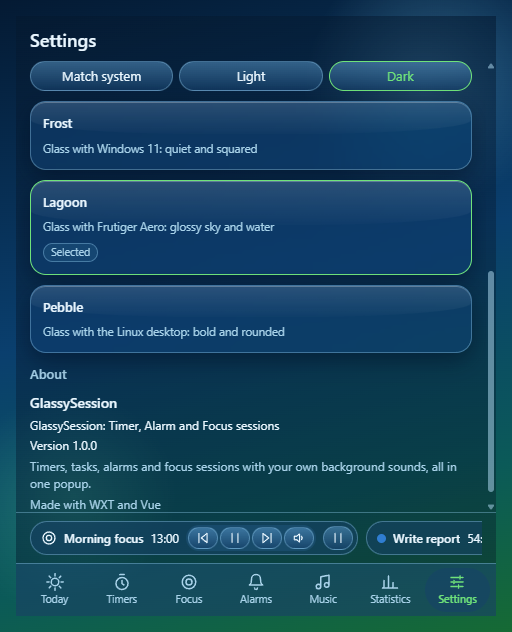

# GlassySession

GlassySession is a browser extension for Chromium browsers and Firefox that keeps your work time in one popup. You save timers and tasks, run them on their own or put tasks into focus sessions with breaks, set alarms, and see how much time each task took this week. Your own audio files can play while you work, and the timers you pin stay in a corner of every web page. Everything stays in your browser.



## What it does

### Timers and tasks

A timer counts down its planned time and rings when it runs out. A task is a timer that stands for work: its time is tracked, you can mark it done, and it can go into a focus session. A task can repeat on chosen days of the week and comes back with its full planned time on each of them. Each timer has a name, an optional description, a colour and its own ring sound, either one of the built-in sounds (Bell, Soft chime, Digital, Marimba) or an audio file of your own. Everything that runs also shows in the running bar above the tabs, with a button to pause it.



### Focus sessions

A focus session splits one or more tasks into focus steps of a set length with breaks between them, one task after another or alternating between them. While it runs you see the current step, what comes up next and when it should end. You can pause it, skip a break, end it early, reorder the steps or add another task for this run only. An end chime plays when a focus step ends and a softer start chime when the next one starts. You pick both in Settings.



### Alarms

An alarm rings at a time of day, either once on a date or on chosen days of the week, and can also show a system notification. You switch each one on or off. Alarms ring while the browser is running. One that came while the browser was closed or the computer was asleep shows a quiet notification saying when it was due.



### Statistics

Statistics shows the time tracked per day for one week at a time, the total for each task, how the repeat days of repeating tasks went, and how much of each task's planned time you used today. You can look at all tasks or one, and go back to earlier weeks. Time from a task you removed stays in the totals as a removed task.



### Playlists and background sounds

In Music you make playlists from your own audio files. Any timer, task or focus session can pick a playlist and a volume as its background sound. The playlist plays while it runs, pauses with it and carries on from the same place in the same file. When several run at once you hear the one started most recently. Its controls let you go to the previous or next file, pause just the sound and change the volume. There are no built-in background sounds and no streaming.



### Sounds and your own audio files

Settings > Sounds holds the end chime, the start chime and the volume of rings and chimes. Your own audio files are stored once in the extension and can be a ring sound, a chime or part of a playlist. Settings lists them with a Delete button, which refuses and names what still plays a file. A file that nothing plays any more is forgotten.



### Overlay on web pages

Pin a timer, a task or a focus session and it shows in a small panel in a corner of every http and https page, with its remaining time and a button to start, pause or resume it. You can collapse the panel or drag it to another corner. It shows only while something is pinned, and you can turn it off for every page in Settings.



### Themes and About

There are three themes, each with a light and a dark version, or one that follows your system: Frost (glass in the style of Windows 11), Lagoon (glossy sky and water) and Pebble (bold and rounded, in the style of the Linux desktop). The About section in Settings shows the version.



The interface is in English.

## Install

Release builds are zip files named `glassy-session-1.0.0-chrome.zip` and `glassy-session-1.0.0-firefox.zip`. To make them yourself, see [Build from source](#build-from-source).

### Chrome and other Chromium browsers

1. Unzip `glassy-session-1.0.0-chrome.zip` into a folder you keep.
2. Open `chrome://extensions`, or your browser's extensions page, and turn on **Developer mode**.
3. Click **Load unpacked** and choose the unzipped folder.

### Firefox

Until the extension is listed on Firefox Add-ons, load it for one session:

1. Open `about:debugging#/runtime/this-firefox`.
2. Click **Load Temporary Add-on** and choose `glassy-session-1.0.0-firefox.zip`.

Firefox removes a temporary add-on when it closes. Once the extension is on Firefox Add-ons, install it from there to keep it.

### Build from source

You need Node.js 22 or newer.

```sh
npm ci
npx wxt zip
npx wxt zip -b firefox
```

`npm ci` also runs `wxt prepare`, which generates the types in `.wxt`. The first `zip` command writes `glassy-session-1.0.0-chrome.zip` to `.output/`, and the second writes `glassy-session-1.0.0-firefox.zip` and `glassy-session-1.0.0-sources.zip`, the sources Firefox Add-ons asks for. To load the extension without zipping, run `npm run build` and load the `.output/chrome-mv3` folder unpacked as above.

## How it was built

### Stack

- [WXT](https://wxt.dev/) builds the extension for Chromium (Manifest V3) and Firefox from one code base. `wxt.config.ts` owns the manifest.
- [Vue 3](https://vuejs.org/) and TypeScript, with a component kit of its own in `src/ui`, styled with plain CSS and custom properties.
- [Vue I18n](https://vue-i18n.intlify.dev/) for the interface texts, which live in `src/locales`.
- [Vitest](https://vitest.dev/) with Testing Library for tests, [Storybook](https://storybook.js.org/) for every component, and ESLint.

### Architecture

The extension runs in three places: the background service worker, the popup, and the overlay, which is a content script in a closed shadow root on each page.

- **One writer.** Only the background changes timers and focus sessions. The popup and the overlay send it commands and redraw when the stored data changes. Every command loads, settles and saves timers and focus sessions together in one write, and refuses a change that would use a task in two places.
- **Ports and adapters.** Domain code never touches the `browser` API. It reaches storage, sound and alarms through ports, and each port has a browser adapter and an in-memory adapter. Tests and Storybook run the real engines over the in-memory adapters.
- **Layers checked by lint.** Code sits in `utils`, `ui`, `domain`, `infrastructure` and `application`, and imports point one way. ESLint enforces that order and which domain areas may import which.
- **Time as stored moments.** A browser can stop the service worker at any moment, so nothing counts time in memory. A running timer stores the moment it started, and remaining time is worked out from that moment and the clock. Browser alarms wake the background for the next ring. A stopped worker loses nothing, and a ring that came while it was stopped is settled when it wakes.
- **Browser differences behind ports.** Chromium plays sounds through an offscreen document and Firefox through its background page. The Chrome build alone asks for the `offscreen` permission.

[AGENTS.md](AGENTS.md) describes where code goes and why, and [glossary.md](glossary.md) defines every term the code and the interface use.

### Test-first

Behaviour was built test-first: one failing test, the least code to pass it, then the next test. Tests sit next to the code they cover. `npx vitest run` runs 1375 tests in 141 files.

## Development

Run the commands from the repository root after `npm ci`.

| Task | Command |
|---|---|
| Develop in Chrome, with reload on change | `npm run dev` |
| Develop in Firefox | `npm run dev:firefox` |
| Type check | `npx vue-tsc --noEmit` |
| Type check and build for Chrome | `npm run build` |
| Type check and build for Firefox | `npm run build:firefox` |
| Pack the Chrome zip | `npm run zip` |
| Pack the Firefox zip and the sources zip | `npx wxt zip -b firefox` |
| Run the tests once | `npx vitest run` |
| Run the tests in watch mode | `npm test` |
| Test coverage | `npm run coverage` |
| Lint | `npm run lint` |
| Lint and fix | `npm run "lint fix"` |
| Storybook on port 6006 | `npm run storybook` |
| Build the static Storybook | `npm run "storybook build"` |
| Render the toolbar icons from `assets/icon.svg` | `npm run icons` |

`npm run dev` opens a separate browser profile with the development build loaded. The development build's name starts with `[INTERNAL]`.

## Privacy

GlassySession collects no data and sends nothing anywhere. It makes no network requests. Timers, tasks, focus sessions, alarms, tracked time, playlists and settings stay in the browser's extension storage, and your own audio files stay in the extension's IndexedDB. Removing the extension removes them. The Firefox build declares that it collects no data.

## License

[MIT](LICENSE)
